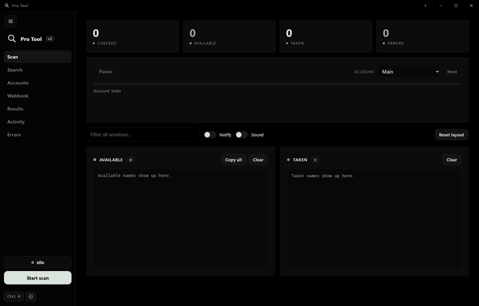
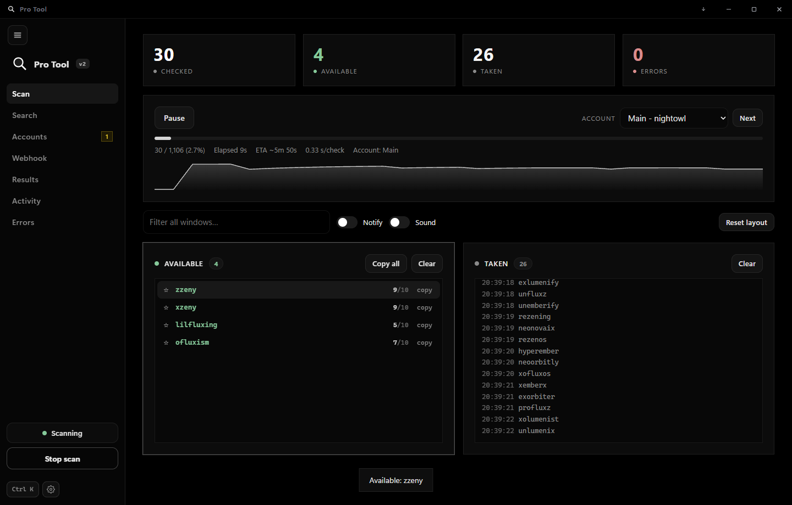
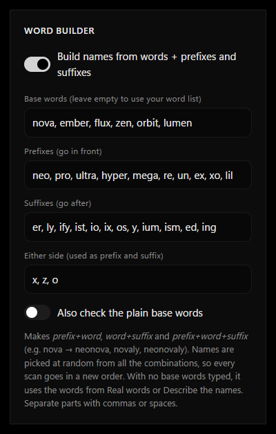
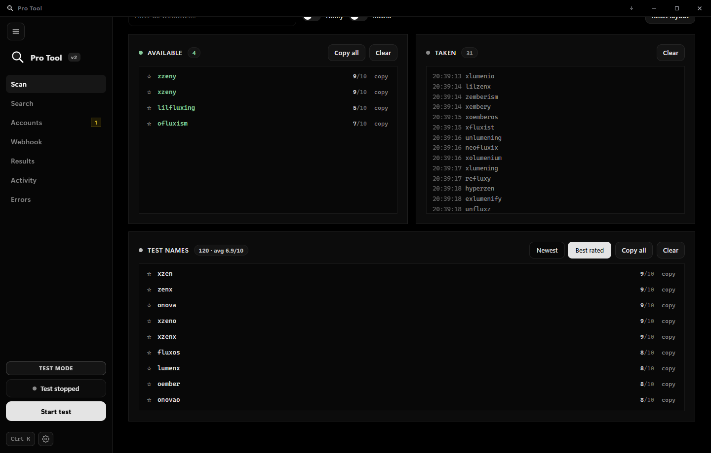
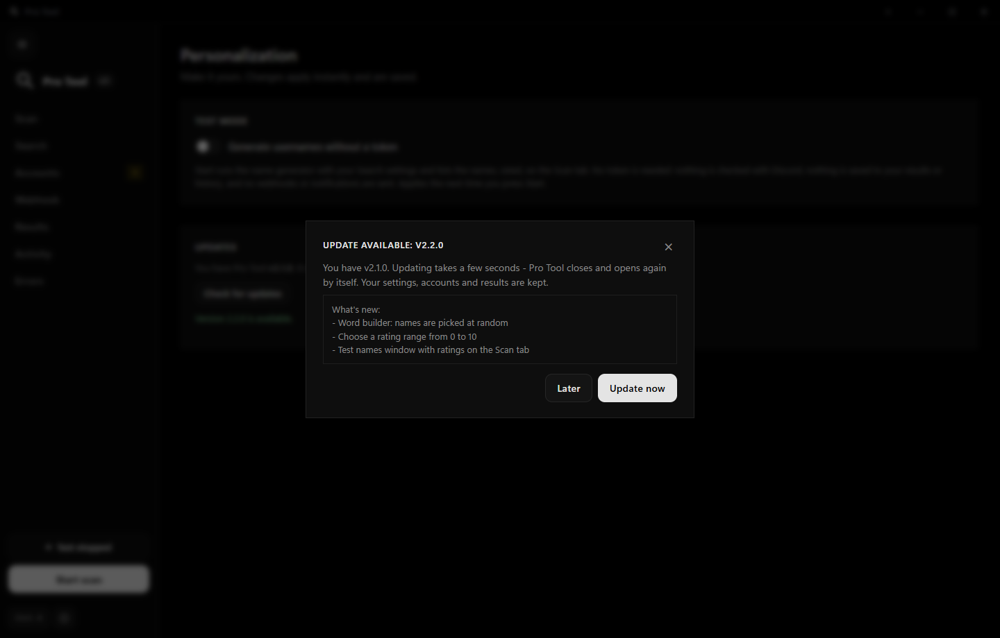

<div align="center">


# Pro Tool

**Find available Discord usernames - fast.**
Pick the kind of names you want, press Start, and Pro Tool checks them for you,
rates every name out of 10 and pings you when it finds a free one.

[](https://github.com/hoqf/pro-tool/releases/latest/download/ProToolV2.exe)

[](https://github.com/hoqf/pro-tool/releases/latest)
[](https://github.com/hoqf/pro-tool/releases)


[](LICENSE)



</div>

## Install in 3 steps
1. **[Download ProToolV2.exe](https://github.com/hoqf/pro-tool/releases/latest/download/ProToolV2.exe)** (about 23 MB).
2. **Double-click it.** If Windows shows *"Windows protected your PC"*, click **More info -> Run anyway**
   ([why?](#why-does-windows-warn-me-when-i-open-it)).
3. **Add an account** on the Accounts page, then press **Start scan**. Want to try it first? Turn on
   **Test mode** (Settings) - it works without an account.

That's it - Pro Tool keeps itself up to date from then on.

---

## Contents
- [Features](#features)
- [FAQ](#faq)
- [Privacy](#privacy)
- [Changelog](CHANGELOG.md)
- [For developers](#for-developers)
- [Credits and license](#credits-and-license)

---

## Features

### Scanning

- **Checks names with Discord** one by one and lists every **available** and **taken** name live.
- **Random delay between checks**, set in milliseconds (e.g. 2000-4000 ms), so requests never arrive on a fixed beat.
- **Slows down by itself when rate limited**, then eases back - no babysitting needed.
- **Breaks** every N checks, a **time limit**, and **stop after finding N** names.
- **Skips names it already checked** in earlier runs (you can forget that history any time).
- **Retry errors** with one click, **pause / resume**, a progress bar with ETA and a live speed chart.
- **Check your own list**: paste names and check exactly those.
- **Presets**: save your search settings and load them again later.

### Choosing what names to make

- Starts with **random 4-letter names** - change anything you like:
- **Length** from 2 to 32 characters, **shortest first** or **random order**.
- **Characters**: letters, digits, underscore and period - any mix.
- **Must contain** some text anywhere, at the start or at the end; **start with / end with**; **skip names containing** words you don't want.
- **Real words** from **52 languages** (downloaded once), or your own word list, with up to 8 words per name.
- **Describe the names**: type a few words like *dark, ocean, fast* and Pro Tool finds related words
  (*abyss, tide, swift...*) to build names from.
- **Only make names rated** from X to Y out of 10 - for example *10 to 10* for only perfect names.

### Word builder


Combines base words with **prefixes** (neo, pro, ultra...), **suffixes** (er, ly, ify...) and
**either-side** parts (x, z, o):

*nova* -> *neonova, novaly, neonovaly, xnova, novaz...*

Names are picked **at random** from every combination, so each scan goes in a new order. Leave the base
words empty to use your word list from *Real words* or *Describe the names*.
<br clear="right">

### Name ratings
Every name gets a **rating out of 10** (hover it in the app to see why):

| Rule | Points |
|---|---|
| Length: 3 or fewer / 4-5 / 6-7 / 8-9 characters | 4 / 3 / 2 / 1 |
| No digits (one digit = 1) | 2 |
| No `.` or `_` (just one = 1) | 2 |
| Easy to say: has a vowel, no run of 5+ consonants or vowels | 1 |
| Flows well: no run of 3+ consonants or vowels | 1 |

Examples: *zed* 10, *nova* 9, *shadow* 8, *xkcd* 7, *strngth* 6.

### Results

- **Available** names with their rating, a **favourite** star and one-click **copy** / **copy all**.
- **Results page** with every available name ever found, a search box, **filter by rating** (10, 9+, 8+...)
  and **download as .txt**.
- **Windows notification** and a sound when a name is found (both optional).

### Accounts and token alerts

- Save up to **50 accounts**; tokens are **encrypted with Windows** and never shown again in full.
- **Switch account mid-scan**, cycle to the next one, or **auto-switch** when one is rate limited.
- **Test** one or **all** accounts, and **import** a .txt of tokens.
- **Token alerts**: when a token stops working (rejected, expired or locked), Pro Tool shows a **yellow alert**,
  **highlights that token in yellow**, adds a count in the menu and sends a Windows notification - even if
  the app is hidden.

### Discord webhook
- Get a message in your own Discord server **the moment a name is found**.
- Optional **summary when a scan ends**, and a **Send test** button to check it works.
- The webhook URL is stored encrypted, like your tokens.

### Test mode

- **Generate names without a token**: nothing is sent to Discord and nothing is saved.
- Every generated name appears on the **Scan** tab in **Test names**, **rated out of 10**, with the average
  rating, **Newest / Best rated** order and copy all - great for tuning your search before a real scan.

### Automatic updates


- Pro Tool checks for a new version a couple of seconds after it opens and asks **Update now / Later**.
- Updating takes a few seconds; settings, accounts and results are kept.
- Every update is **digitally signed** - the app refuses anything that isn't signed by the publisher.
- **Settings -> Updates** shows your version and has a **Check for updates** button.

### The app itself
- Its own **borderless window**, smooth at your monitor's full refresh rate (60, 144, 240 Hz...).
- **Sidebar** menu, clean black and grey design, smooth scrolling.
- **Drag the windows** on the Scan tab to rearrange them; filter all windows at once.
- **Command palette** (**Ctrl + K**) for quick actions.
- **Minimize to background**: keeps scanning from the tray icon by the clock.

---

## FAQ

#### Why does Windows warn me when I open it?
Windows SmartScreen warns about any app that isn't signed with a paid code-signing certificate and hasn't been
downloaded by many people yet. Click **More info -> Run anyway**. The full source code is right here, so you can
see exactly what it does.

#### Is it safe? Can my account get in trouble?
Pro Tool runs only on your PC and talks only to Discord, GitHub and (if you use it) Datamuse - see
[Privacy](#privacy). Checking lots of names does send many requests to Discord with your account, which Discord
may rate limit or flag, so **use an alt account** and keep a sensible delay between checks.

#### How do I get my token?
Open **Accounts -> How to get a token** in the app for a step-by-step guide. Never share your token with anyone.

#### Where is my data stored?
In a `dist` folder next to `ProToolV2.exe`: settings, results, history and your encrypted accounts.
To move Pro Tool, move the exe **and** that folder together. Deleting the folder resets everything.

#### How do updates work?
When a new version is published here, Pro Tool offers it the next time it opens (**Update now / Later**).
It downloads the new exe, checks its signature, swaps itself and reopens - your data stays put.

#### A name showed as available but I couldn't claim it.
Someone may have taken it in the meantime, or Discord may reserve some names. Claim promising names quickly.

#### Does it work on Mac or Linux?
No - Pro Tool is made for Windows 10 and 11.

#### I found a bug / have an idea.
[Open an issue](https://github.com/hoqf/pro-tool/issues/new/choose) - there are short forms for bugs and ideas.

---

## Privacy
- Everything stays on your PC: settings, results and history live in the `dist` folder next to the app.
- Tokens and webhook URLs are encrypted with your Windows account.
- Pro Tool only talks to: **Discord** (to check names), **GitHub** (word lists and updates) and, only if you use
  *Describe the names*, **Datamuse** (it receives just the describing words you type).

---

## For developers

<details>
<summary>Run from source, project layout and publishing updates</summary>

**Run from source**
```
pip install requests pywebview pythonnet pillow cryptography
python src/dsv_web.py
```

**Project layout**
| Path | What it is |
|---|---|
| `src/dsv_web.py` | The app: local server, scanner, window, updates |
| `src/dsv_gui.py` | Core name generator and Discord helpers |
| `src/web/index.html` | The whole interface |
| `release.py` | Builds, signs and publishes an update |
| `docs/` | README pictures |

**Publishing an update** (maintainer only)
```
python release.py --make-key                  # once: creates your private signing key
python release.py 2.2.0 "What changed"        # build, sign, publish, update CHANGELOG.md
```
The signing key is kept outside this folder (`%USERPROFILE%\.protool-release`) and must never be shared.

</details>

---

## Credits and license
Based on **DSV by suenerve** - original author credit is required wherever this code is used.
**Non-commercial use only.** See [LICENSE](LICENSE).
