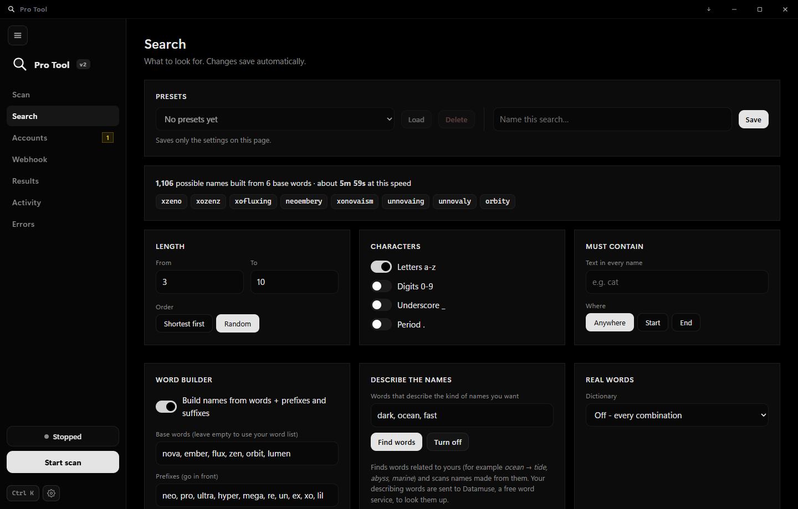
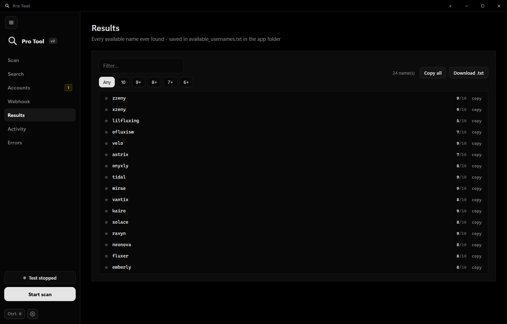
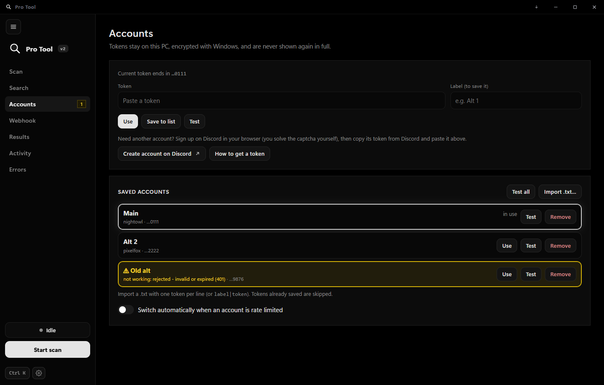
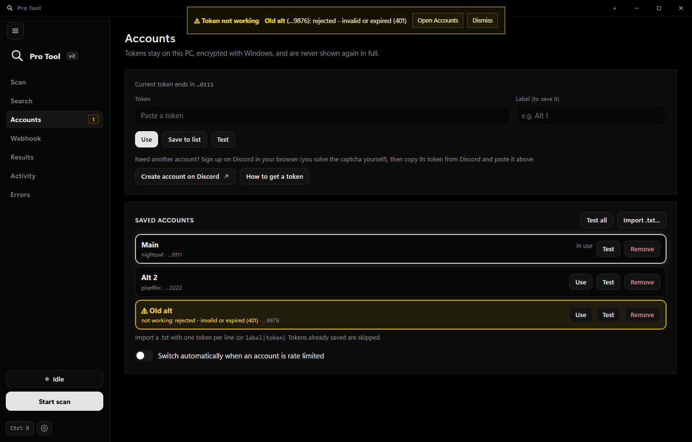
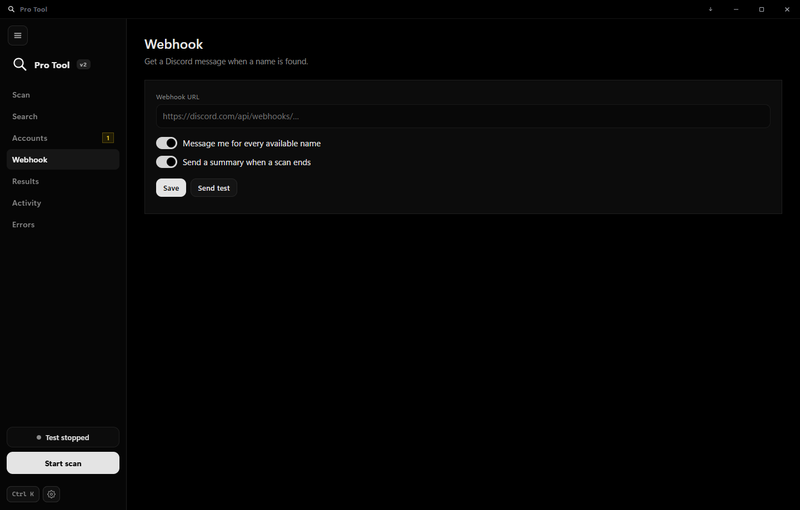

# Pro Tool v2

A fast, good-looking Windows app that finds available Discord usernames. Pick the kind of names you want
(length, characters, real words, prefixes and suffixes, a minimum rating), press **Start**, and Pro Tool
checks them for you, lists the free ones, rates them out of 10 and can ping you on Discord when it finds one.


**[Download the latest version](https://github.com/hoqf/pro-tool-updates/releases/latest)** - get
`ProToolV2.exe`, double-click it, done. It updates itself from then on.

---

## Contents
- [Features](#features)
  - [Scanning](#scanning)
  - [Choosing what names to make](#choosing-what-names-to-make)
  - [Name ratings](#name-ratings)
  - [Results](#results)
  - [Accounts and token alerts](#accounts-and-token-alerts)
  - [Discord webhook](#discord-webhook)
  - [Test mode](#test-mode)
  - [Automatic updates](#automatic-updates)
  - [The app itself](#the-app-itself)
- [Getting started](#getting-started)
- [Privacy](#privacy)
- [Running from the source code](#running-from-the-source-code)
- [Publishing an update](#publishing-an-update)
- [Credits and license](#credits-and-license)

---

## Features

### Scanning
- **Checks names with Discord** one by one and lists every **available** and **taken** name live.
- **Random delay between checks**, set in milliseconds (e.g. 2000-4000 ms), so requests never arrive on a fixed beat.
- **Slows down by itself when rate limited**, then eases back - no babysitting needed.
- **Breaks** every N checks, a **time limit**, and **stop after finding N** names.
- **Skips names it already checked** in earlier runs (you can forget that history any time).
- **Retry errors** with one click after a network hiccup.
- **Pause / resume**, a progress bar with ETA, and a live speed chart.
- **Check your own list**: paste names and check exactly those.
- **Presets**: save your search settings and load them again later.

### Choosing what names to make

- **Length** from 2 to 32 characters, **shortest first** or **random order**.
- **Characters**: letters, digits, underscore and period - any mix.
- **Must contain** some text anywhere, at the start or at the end; **start with / end with**; **skip names containing** words you don't want.
- **Real words** from **52 languages** (downloaded once), or your own word list, with up to 8 words per name.
- **Describe the names**: type a few words like *dark, ocean, fast* and Pro Tool finds related words
  (*abyss, tide, swift...*) to build names from.
- **Word builder**: combines base words with **prefixes** (neo, pro, ultra...), **suffixes** (er, ly, ify...)
  and **either-side** parts (x, z, o), e.g. *nova* -> *neonova, novaly, neonovaly, xnova*. Names are picked
  **at random** from every combination, so each scan goes in a new order.
  
- **Only make names rated** from X to Y out of 10 - for example *10 to 10* for only perfect names.

### Name ratings
Every name gets a **rating out of 10** (hover it to see why):

| Rule | Points |
|---|---|
| Length: 3 or fewer / 4-5 / 6-7 / 8-9 characters | 4 / 3 / 2 / 1 |
| No digits (one digit = 1) | 2 |
| No `.` or `_` (just one = 1) | 2 |
| Easy to say: has a vowel, no run of 5+ consonants or vowels | 1 |
| Flows well: no run of 3+ consonants or vowels | 1 |

Examples: *zed* 10, *nova* 9, *shadow* 8, *xkcd* 7, *strngth* 6.

### Results

- **Available** names with their rating, a **favourite** star and one-click **copy** / **copy all**.
- **Results page** with every available name ever found, a search box, **filter by rating** (10, 9+, 8+...)
  and **download as .txt**.
- **Windows notification** and a sound when a name is found (both optional).

### Accounts and token alerts

- Save up to **50 accounts**; tokens are **encrypted with Windows** (DPAPI) and never shown again in full.
- **Switch account mid-scan**, cycle to the next one, or **auto-switch** when one is rate limited.
- **Test** one or **all** accounts, and **import** a .txt of tokens.
- **Token alerts**: when a token stops working (rejected, expired or the account is locked), Pro Tool shows a
  **yellow alert**, **highlights that token in yellow** in the list, adds a count in the menu and sends a
  Windows notification - even if the app is hidden.
  

### Discord webhook

- Get a message in your own Discord server **the moment a name is found**.
- Optional **summary when a scan ends**, and a **Send test** button to check it works.
- The webhook URL is stored encrypted, like your tokens.

### Test mode

- **Generate names without a token**: nothing is sent to Discord and nothing is saved.
- Every generated name appears on the **Scan** tab in **Test names**, **rated out of 10**, with the
  average rating, **Newest / Best rated** order and copy all. Great for tuning your search before a real scan.

### Automatic updates

- Pro Tool checks for a new version when it opens and asks **Update now / Later**.
- Updating takes a few seconds; settings, accounts and results are kept.
- Every update is **digitally signed** - the app refuses anything that isn't signed by the publisher, so a
  fake or tampered download can't be installed.
- **Settings -> Updates** shows your version and has a **Check for updates** button.

### The app itself
- Its own **borderless window**, smooth at your monitor's full refresh rate (60, 144, 240 Hz...).
- **Sidebar** menu (toggle with the three-bar button), clean black and grey design, smooth scrolling.
- **Drag the windows** on the Scan tab to rearrange them; filter all windows at once.
- **Command palette** (**Ctrl + K**) for quick actions.
- **Minimize to background**: keeps scanning from the tray icon by the clock.
- Resize from any edge or corner; click the taskbar icon to minimize.

---

## Getting started
1. Download **`ProToolV2.exe`** from [Releases](https://github.com/hoqf/pro-tool-updates/releases/latest) and run it.
   (Windows may show a SmartScreen notice the first time because the app isn't commercially code-signed:
   **More info -> Run anyway**.)
2. Open **Accounts**, paste your token, give it a label and save it.
   Use an alt account - the **Getting your token** guide on that page shows how.
3. Set up **Search** the way you like (or try **Test mode** first).
4. Press **Start scan**.

Needs Windows 10 or 11 (the Microsoft Edge WebView2 runtime it uses is built in).

## Privacy
- Everything stays on your PC: settings, results and history live in a `dist` folder next to the app.
- Tokens and webhook URLs are encrypted with your Windows account.
- Pro Tool only talks to: **Discord** (to check names), **GitHub** (word lists and updates) and, only if you use
  *Describe the names*, **Datamuse** (it receives just the describing words you type).

## Running from the source code
```
pip install requests pywebview pythonnet pillow cryptography
python dsv_web.py
```
`dsv_web.py` is the app (server, scanner and window), `web/index.html` is the whole interface,
`dsv_gui.py` holds the core name generator, `wpf_window.py` is an optional see-through window,
and `release.py` builds and publishes updates.

## Publishing an update
For the maintainer, from this folder:
```
python release.py --make-key                  # once: creates your private signing key
python release.py 2.2.0 "What changed"        # build, sign and publish version 2.2.0
```
The signing key is kept outside this folder (`%USERPROFILE%\.protool-release`) and must never be shared.

## Credits and license
Based on **[DSV by suenerve](https://github.com/suenerve/DSV)** - original author credit is required wherever
this code is used. **Non-commercial use only**, as in the original license.
